<p align="center">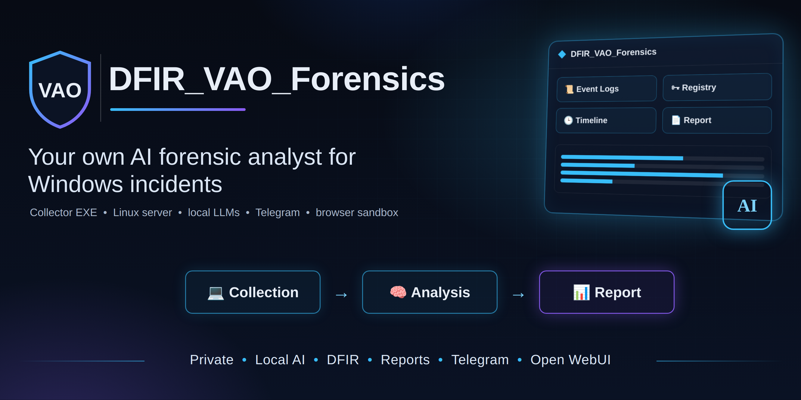</p>

<div align="center">

# 🛡️ DFIR_VAO_Forensics

**VAO Forensics** · DFIR Bot

**Your own AI forensic analyst for Windows incidents: private, local, in Telegram and in the browser.**

Collect evidence from a Windows PC → the server analyses it with local AI → you get a clear report.<br>
No cloud. No data leaves your server.


**[⬇️ Download the collector builder (latest)](../../releases/latest)** · **[✨ The idea](#-the-idea-in-16-slides)** · **[🎬 Demo](#-demo-the-dfir-module-in-real-time)** · **[🚀 Quick start](#-quick-start-3-steps)** · **[🤖 Manual for AI assistants](README_FOR_AI.md)**

</div>

## ✨ The idea in 16 slides

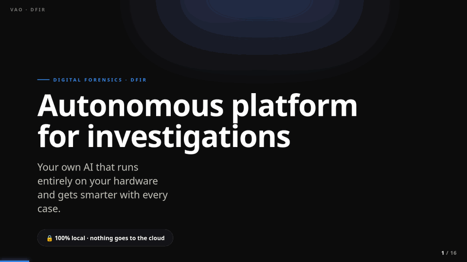

---

## 🎬 Demo: the DFIR module in real time

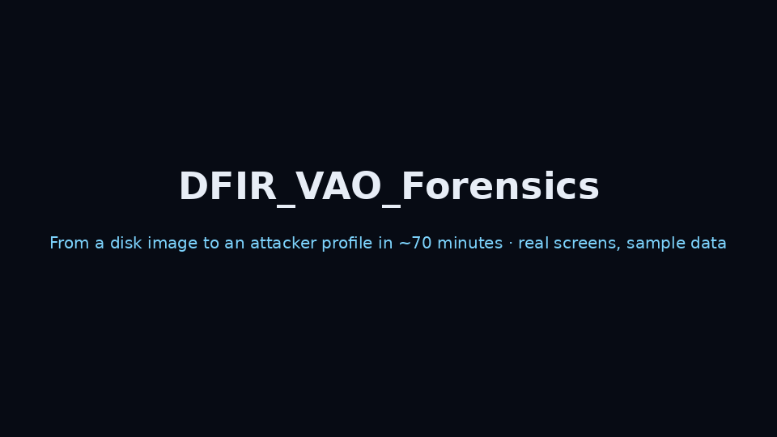

16 slides, every screen in English. One PC, local AI, no internet. The clock in the corner shows how long each step really takes (real screens, sample data in place of the real case):

| Step | Clock | Takes |
|---|---|---|
| Collector: three questions, then it parses the logs from a mounted disk image | 15:21 → 15:36 | 14 min |
| Upload (up to 10 GB) and import into the bot | 15:37 → 15:51 | 14 min |
| First report: initial access, timeline, IOCs, each line with its source | 15:51 → 16:10 | 19 min |
| Report with the built-in question-and-answer check | 16:10 → 16:26 | 16 min |
| A link to other cases is found | 16:26 | — |
| Attacker profile built from all cases | 16:28 → 16:30 | 2 min |
| Your own question in the case: the bot searches and answers | 16:31 → 16:32 | 1 min |

---

<p align="center">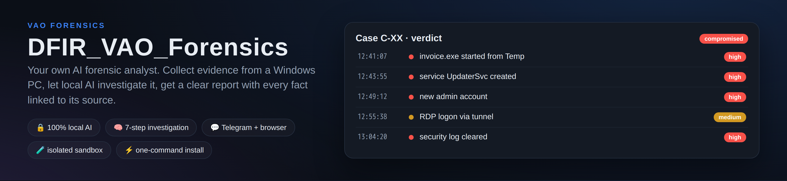</p>

<p align="center">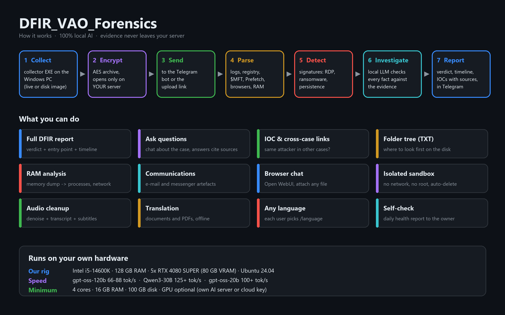</p>

---

## What it does

| | |
|---|---|
| 🧰 **Collects** | One EXE collects event logs, registry, $MFT, Prefetch/Amcache/ShimCache, browsers, RAM and more from a live PC or a disk image, into an **encrypted** archive that only *your* server can open. |
| 🔍 **Analyses** | Parses everything into a database, runs deterministic threat signatures (RDP brute force, ransomware, persistence, defence evasion, known-bad hashes) and then lets a local AI investigate. |
| 📄 **Reports** | Verdict, timeline, IOCs, every fact linked to its source file and record, delivered in Telegram in the user's language. |
| 💬 **Chats** | A ChatGPT-like browser chat (Open WebUI). Attach **any** file (archive, logs, CSV, EVTX, database): it is opened in an **isolated sandbox** and the AI explains what is inside. |
| 🔒 **Stays private** | Models run on your own GPUs. Uploaded files are deleted after 24 hours. |

## Everything it can do

<p align="center">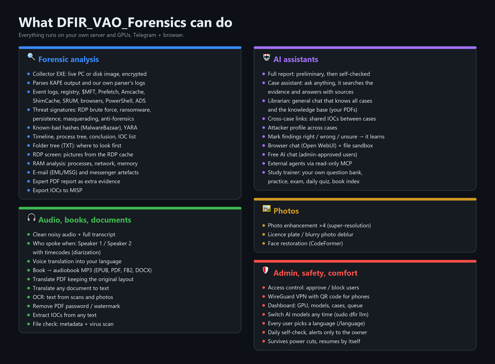</p>

<details open>
<summary><b>🔍 Forensic analysis</b></summary>

<p align="center">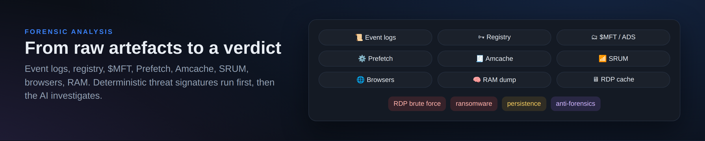</p>


- **Collector EXE** for Windows: works on a live PC or a mounted disk image; the archive is encrypted for your server only.
- **Reads KAPE output and our own parser's output**, or plain KAPE CSV/JSON logs you send.
- **Artefacts:** event logs, registry, $MFT, Prefetch, Amcache, ShimCache, SRUM, browser history, PowerShell transcripts, hidden NTFS streams (ADS).
- **Threat signatures** run before the AI: RDP brute force, ransomware, persistence, masquerading system processes, anti-forensics (log clearing), known-bad hashes (MalwareBazaar), YARA rules, comparison with a clean Windows.
- **Timeline**, **process tree**, short **conclusion**, **IOC list**.
- **Folder tree (TXT)** of the whole disk with the places to check first.
- **RDP screen:** turns the RDP bitmap cache into pictures, so you see what the attacker saw.
- **RAM analysis:** processes, network connections and more from a memory dump.
- **E-mail** (EML/MSG) and messenger artefacts.
- An **expert's PDF report** can be added as extra evidence.
- **Export IOCs to MISP.**
</details>

<details open>
<summary><b>🤖 AI assistants</b></summary>

<p align="center">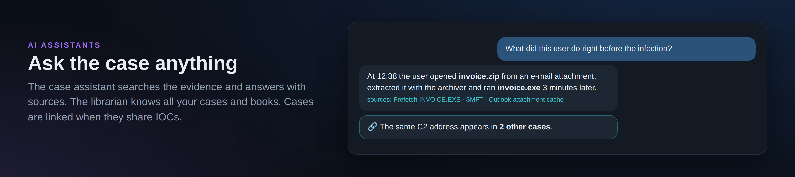</p>


- **Full DFIR report:** a quick preliminary report first, then the full one after the AI has checked its own answers against the evidence.
- **Quick AI analysis** (minutes) or **extended AI analysis** (deeper, more questions); live **analysis status** while it runs.
- **Big uploads** up to 10 GB with a progress page; collector archive, KAPE logs, e-mail, RAM dump, expert PDF.
- **Raw artefacts** and **log analysis** of a case on request; **my cases**: open, label, archive, delete.
- **Case assistant:** inside a case, ask anything ("what did this user do before the infection?"); it searches the evidence and answers with sources.
- **Librarian:** a general chat that knows all your cases and the knowledge base (your PDFs, books, courses).
- **Cross-case links:** shared IOCs between cases, and an **attacker profile** built across cases.
- **It learns:** mark each finding *right / wrong / unsure*; checked facts are reused in later cases.
- **Browser chat** (Open WebUI): attach any file, it is opened in an isolated sandbox and explained.
- **Free AI chat** for users the admin allows.
- **External AI agents** can read cases through a read-only MCP server.
- **Study trainer:** load your own question bank and courses; practice, exam mode, daily quiz of 10, weak topics; offline index of your own books.
</details>

<details open>
<summary><b>🎧 Audio, books and documents</b></summary>

<p align="center">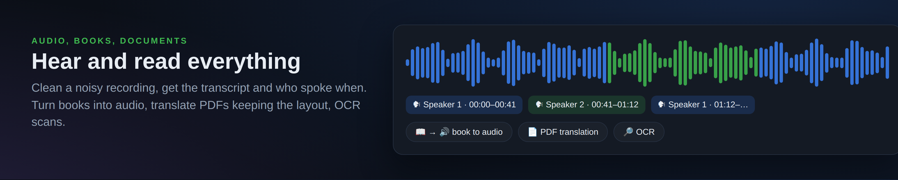</p>


- **Clean a noisy recording** and get the full **transcript**.
- **Who spoke when:** *Speaker 1 / Speaker 2* with timecodes (diarization).
- **Voice translation:** foreign-language audio becomes speech in your language.
- **Book → audiobook** (MP3) from EPUB, PDF, FB2, DOCX or TXT.
- **Translate a PDF keeping its original layout**, or any document to plain text.
- **OCR:** text from scans and photos.
- **Remove a PDF password or watermark.**
- **Extract IOCs** from any pasted text; **file check:** metadata + virus scan.
</details>

<details open>
<summary><b>🖼 Photos</b></summary>

<p align="center">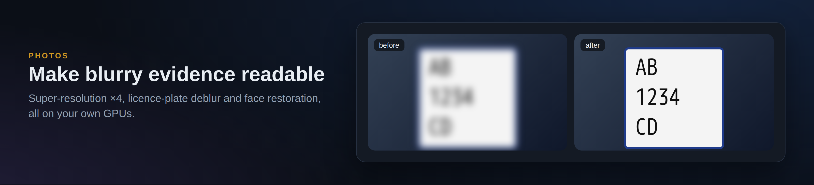</p>


- **Enhance a photo ×4** (super-resolution).
- **Licence plate / blurry photo:** deblur to read it.
- **Restore faces** (CodeFormer).
</details>

<details open>
<summary><b>🛡 Admin, safety and comfort</b></summary>

- **Access control:** approve or block users, admin-only tools (details below).
- **VPN:** WireGuard with a QR code for phones, or ZeroTier when there is no public IP.
- **Dashboard:** GPUs, models, cases, queue.
- **Switch AI models any time** (`sudo dfir llm`); every user picks a **language** (`/language`).
- **Daily self-check**; alerts go only to the owner.
- **Survives power cuts:** everything starts again by itself and unfinished work continues.
</details>

## 🌐 Web portal for your team (browser, PC or phone)

Besides the Telegram bot, the project runs a private web portal (Open WebUI) that colleagues reach over the VPN — from a PC or a phone, with no client to install.

- **Any file, read in full** — PDF, Word/Excel, raw logs, CSV/JSON: the model reads the whole file, not three fragments.
- **Chats and projects** — memory works inside a chat; a project shares memory and sources across all its chats. Project sources are kept; files dropped into a chat are removed after 24 h.
- **Adapts to each person** — every account quietly builds a work profile (focus area, preferred style) and its own procedures. Nothing is shared between users.
- **Built-in procedures** — 18 curated DFIR playbooks (Windows logons and RDP, persistence, execution artefacts, PowerShell, lateral movement, exfiltration, Android, iOS, documents, phishing, Linux, reporting) are applied automatically when a question needs them.
- **Threat intelligence** — IP and domain enrichment through Silent Push (VPN/Tor/hosting flags, passive DNS), with a daily quota.
- **Personal sandbox** — the assistant can run code and install tools in an isolated per-user container: internet only to package sources (pip, GitHub, Debian) through an allow-list proxy, no access to case data, the host or other users.
- **Live status** — a progress bar in the chat while a model loads.
- **Safety by default** — local models only, uploaded content is treated as data and never as instructions, nightly backups with an integrity check, and a self-healing watchdog that checks the portal and the bot every 12 minutes and reports to the owner.

## 🔐 Access by approval and the admin panel

<p align="center">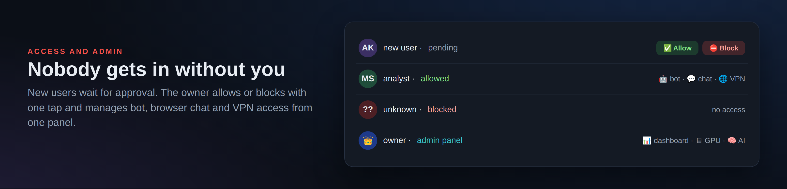</p>

**The bot works only for the people you allow.** When a stranger writes to it, the bot blocks them and immediately tells
the owner (recognised by the Telegram ID given during install), with a button to **allow or block** that person.
The AI chat inside the bot is protected the same way. The browser chat has no self-registration: only the admin creates accounts.

<table>
<tr><td width="50%" valign="top">

**What the admin panel has** (Telegram, owner only)

- 🔐 **Access management:** pending / allowed / blocked users, open a user, allow or block with one tap
- 👤 **User activity:** who uploaded what and when, per-user dossier
- 🌐 **VPN access** for a user (WireGuard config + QR)
- 🌐 **Dashboard** and 🖥 **GPU / AI status**
- 🧠 **AI control:** big-model mode for agents, normal mode, stop a stuck model, free the GPUs for other jobs
- 🤖 **Connect an AI agent:** ready settings for external AI agents
- 📚 **Knowledge base:** upload, view, repair, delete documents
- 🎯 **Skills** and 🧩 **aliases:** teach the bot your own shortcuts
- 🛡 **Export all IOCs to MISP**
- 🧪 **Fine-tune dataset export** from checked reports
- 🗑 **Delete or archive** cases and data (archive keeps the knowledge, frees disk space)
- 🧰 **Heavy tools** (audio, photo, translation) are admin-only by default, light tools are open to everyone

</td><td width="50%" valign="top">

**Three doors, one person**

Each approved person can get up to three ways in, managed from the same panel:

| Door | What they get |
|---|---|
| **Telegram bot** | cases, reports, assistant |
| **Browser chat** | Open WebUI account, files in the sandbox |
| **VPN** | WireGuard tunnel to the server |

Each door is granted and revoked from the same panel; the VPN is switched off through a queue, so its admin password never enters the bot.
The browser-chat password is stored only as a hash; the VPN private key is handed over once and never kept.

</td></tr>
</table>

## How it works

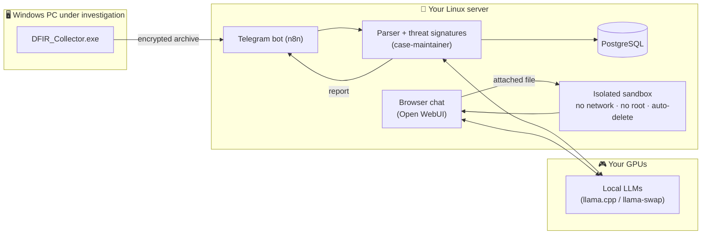

## Requirements

| | Minimum | Recommended | What we run |
|---|---|---|---|
| **OS** | Ubuntu 22.04 / 24.04 or Debian 12 (a real machine or a VM; an LXC container only if privileged) | Ubuntu 24.04 | Ubuntu 24.04 (VM) on a Windows host |
| **CPU** | 4 cores | 8+ cores | Intel Core i5‑14600K (14 cores) |
| **RAM** | 16 GB | 64 GB | 128 GB |
| **Disk** | 100 GB free | 500 GB SSD | NVMe SSD |
| **GPU** | none (use your own AI server or a cloud key) | 1× NVIDIA 16 GB | **5× NVIDIA RTX 4080 SUPER (80 GB VRAM)** |
| **Models** | `small`: gpt-oss‑20b | `medium`: + Gemma‑4‑31B | `large`: + gpt-oss‑120b |

**Measured on our rig, everything local:**

| Model | Role | Speed |
|---|---|---|
| gpt-oss‑120b (5 GPUs) | deep analysis, agents | **66–88 tokens/s** |
| Qwen3‑30B‑A3B (2 GPUs) | uncensored assistant / agents | **125+ tokens/s** |
| gpt-oss‑20b (1 GPU) | fast bot answers | 100+ tokens/s |

> No GPU? Choose **server** (point the bot at any OpenAI-compatible server, e.g. a Windows PC with GPUs) or **cloud** (your API key; the installer warns you that evidence then leaves the server).

## 🧭 Where it runs (pick yours, the installer asks)

| Your setup | Answer at "AI" | What happens |
|---|---|---|
| Ubuntu on a PC with NVIDIA cards | **local** | cards detected; the installer offers the driver (one reboot) and picks models by VRAM |
| Ubuntu **VM** on a Windows PC with the cards (VMware, Hyper-V) | **server** | run `DFIR_VAO_Host_Agent.exe` on Windows: it installs the model server with SHA-256 checks and gives the VM an address + token |
| GPUs in **another** PC | **server** | the same Host Agent there, the two machines joined by VPN |
| No GPU at all | **cloud** | OpenAI, Anthropic, Gemini, OpenRouter, Groq, Mistral, DeepSeek or any OpenAI-compatible URL (you are warned that evidence text leaves the server) |

**VPN for your team** (portal and upload page from outside; Telegram works without it through ngrok):
**WireGuard** if you have a public IP (fast, QR code for phones) · **ZeroTier** if you do not (free, no port forwarding, can be slower) · **none** for the local network only.

> Want another AI to do it with you? Give it **[README_FOR_AI.md](README_FOR_AI.md)**: every question, every install step and how to verify it.

## 🚀 Quick start (3 steps)

### 1. Install the server

```bash
sudo apt-get install -y git
git clone https://github.com/vao-forensics/DFIR_VAO_Forensics.git
cd DFIR_VAO_Forensics
sudo ./install.sh
```

The installer asks a few simple questions, **in your language**:

1. **Language**
2. **AI**: your GPUs, your AI server, or a cloud provider
3. **Telegram**: create a bot with [@BotFather](https://t.me/BotFather), paste the token, send `/start` to your bot
4. **VPN** (optional: WireGuard with a QR code, or ZeroTier without a public IP)
5. **Your logins and passwords** for the browser chat and the database. Press **Enter** to get a strong generated password instead
6. **Review screen**: change anything, then install

**Everything happens with your consent.** First the installer shows what it will install (Docker, n8n, Open WebUI,
PostgreSQL, AI models...) and under which licences, plus a short agreement. You accept it yourself; nothing is
installed without your "yes". AI, drivers, VPN: all your choice. The installer shows what it sees on your hardware and
what it recommends, and you decide.

Then it installs everything by itself: Docker, GPU drivers if needed, models, containers, the sandbox. When it finishes, **your bot sends you a message in Telegram**. That message means the whole chain works.

> 💡 Stuck at a question? Type **`?`** and press Enter. You get an explanation and a ready text to paste into ChatGPT or Gemini (without your passwords).

### 2. Build your collector (on any Windows PC)

1. Download **`DFIR_VAO_Collector_Builder_v1.0.exe`** from [**Releases**](../../releases).
2. Run it and paste the **seal line** (`dfir-seal-1:...`) that the installer printed at the end.
3. Point it at `kape.zip` ([free from Kroll](https://www.kroll.com/en/services/cyber-risk/incident-response-litigation-support/kroll-artifact-parser-extractor-kape); KAPE may not be redistributed).
4. Press **Download everything and build**. You get `DFIR_Collector.exe`.

The builder downloads ~36 open-source forensic tools from their authors (EZ Tools, Hayabusa, Chainsaw, RegRipper, Autoruns…) and writes `TOOLS_PROVENANCE.txt` with the source and SHA‑256 of every file.

> **Ready-made build.** The author's own build `DFIR_Collector_v4.exe` (24.10.2026, 641 484 656 bytes)
> bundles KAPE and Sysinternals, whose licences forbid public redistribution, so it is shared **on request only**
> (e.g. for reviewers). Its SHA‑256, to check a copy you were given:
> `c60e431c557e4fbbfc7d16fab28d08735ec0b7be85b227ccd2935a1d214dab9c`
> (Windows: `certutil -hashfile DFIR_Collector_v4.exe SHA256`).

### 3. Investigate

1. Run `DFIR_Collector.exe` **as administrator** on the PC you want to check.
2. Send the archive to your bot in Telegram (or upload it through the link the bot gives you).
3. Get the report. Ask follow-up questions in the chat.

## Screenshots

| The bot menu in Telegram | The report arrives in Telegram |
|---|---|
| 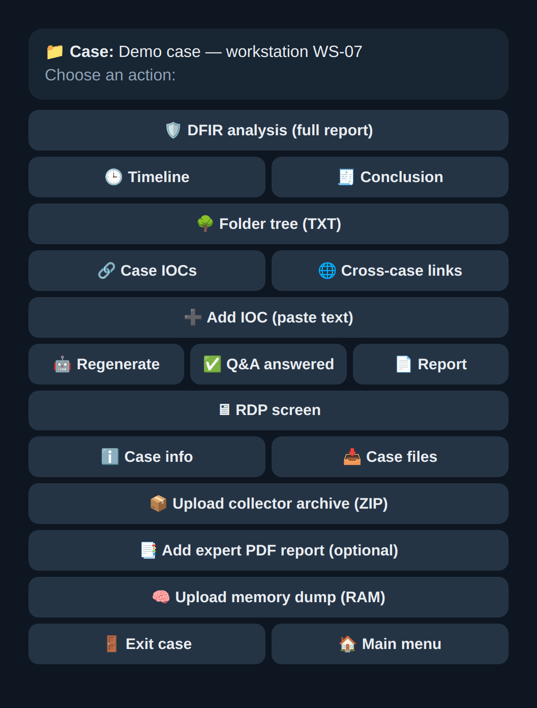 | 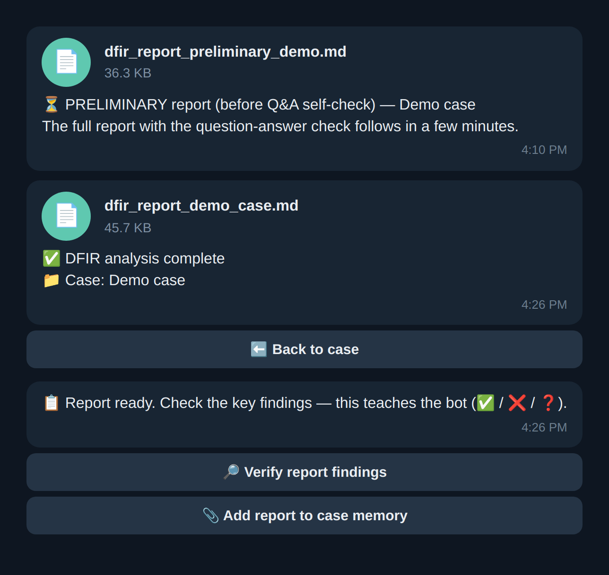 |
| Every button is one action on the case: full report, timeline, conclusion, folder tree, IOCs, links to other cases, RDP screen, upload a collector archive, a PDF or a RAM dump. | A quick preliminary report first, then the full one after the AI has checked its own answers. You mark findings ✅ / ❌ / ❓ and the bot learns. |

**A report (demo case):** verdict first, then the timeline; every line points to its evidence.

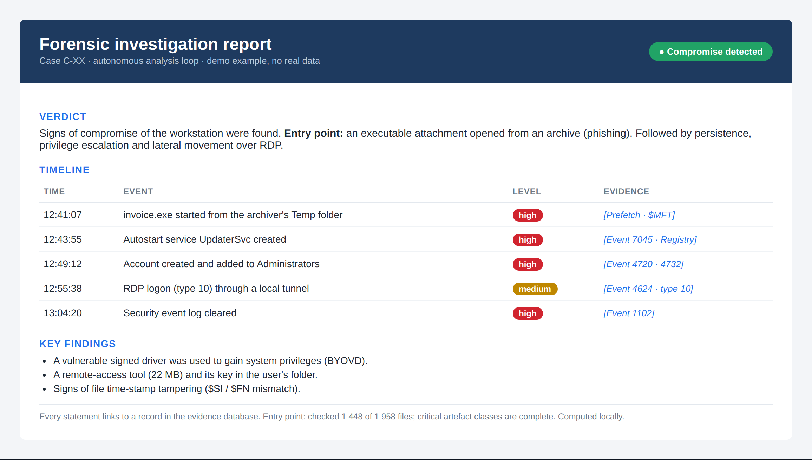

*Screens show demo data in English; the bot speaks the language each user picks with `/language`.*

**Under the hood:** all services run as Docker containers on your server.

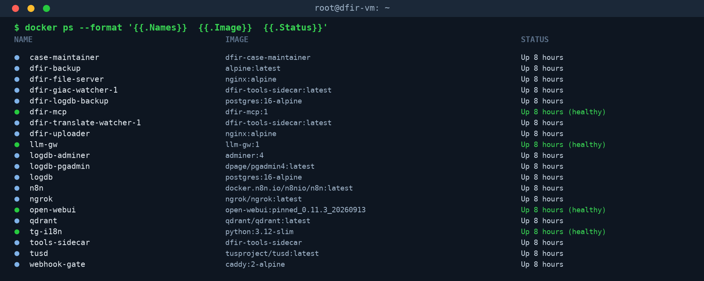

**Browser chat:** attach a file and ask. Here a Windows log (demo data) is analysed in the isolated sandbox and explained by a local 30B model.

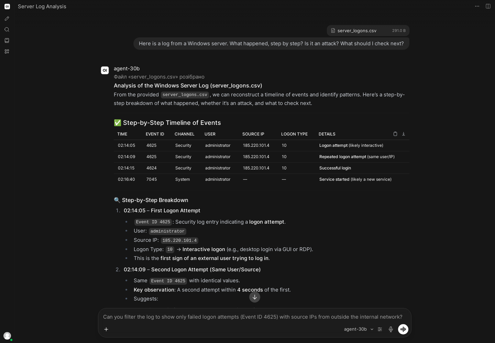

## Everyday commands

| `sudo dfir …` | |
|---|---|
| `status` | containers, AI, Telegram, disk |
| `llm` | switch the AI or its models |
| `lang` | default bot language |
| `logs [container]` · `restart` · `update` | the usual |
| `password` | a new password for the browser chat (Open WebUI) admin |
| `help-ai` | a status block (no secrets) to paste into any AI |

Your logins are saved in `~/DFIR_VAO_credentials.txt` (only you can read it) and in `state/credentials.txt`. Lost the browser-chat password? `sudo dfir password` sets a new one.

## Security

- **Browser chat:** sign-up is off, new users wait for admin approval; code execution, web search and sharing are disabled.
- **Sandbox:** every attached file is opened in a throw-away container: **no network, no root, read-only system, CPU/RAM/time limits, archive-bomb protection**, deleted after the analysis.
- **Encryption:** collector archives are encrypted for one server; the private key never enters the sandbox.
- **Retention:** files uploaded in the chat are deleted after **24 hours**.
- **Telegram:** reports go only to the owner chat chosen during install.
- **Self-check:** after every start of the server and every morning the bot checks itself (containers, database, AI,
  Telegram) and writes to the owner only when something is wrong.

## ❤️ Why this project exists

I built DFIR_VAO_Forensics on my own time and at my own expense, over about a year, with no funding.
It is my first public project on GitHub; earlier ones stayed private.

It stands on the shoulders of tools I use and respect: Eric Zimmerman's tools, KAPE, Hayabusa, Chainsaw,
RegRipper, Sysinternals, llama.cpp, Open WebUI and many more (see `TOOLS_PROVENANCE.txt` after a build).
With some years of DFIR experience, I wanted to give something back: put these tools together into one
pipeline that goes from evidence to a clear, checked report, on your own hardware.

Today I use it myself every day. If it helps you, a ⭐ means a lot, and there is much more I would like to add.

Found a vulnerability? See [SECURITY.md](SECURITY.md).

## 📄 Research article and reproducibility

This system is the subject of a research article on an autonomous LLM-based forensic analysis loop
(in Ukrainian, prepared for publication). Measurements, fault-injection scripts and a
reproducibility check are published separately:
**[vao-forensics/llm-forensics-article-materials](https://github.com/vao-forensics/llm-forensics-article-materials)**.

## Help

- 🤖 **[README_FOR_AI.md](README_FOR_AI.md)**: the full manual. Give it to any AI assistant and it can install, check and repair the bot with you.
- 🤖 **[docs/AI_HELP.md](docs/AI_HELP.md)**: a short block to paste into ChatGPT / Gemini.

## Not included

- AI model weights: the installer downloads them from Hugging Face.
- KAPE, THOR, Magnet DumpIt: licensed per user, you add them yourself.
- Case data, secrets, training material: never in this repository.

---

<div align="center"><sub>© 2026 VAO · DFIR_VAO_Forensics · licensed under <b>AGPL-3.0</b> (see <code>LICENSE</code>) · <a href="THIRD_PARTY_NOTICES.md">third-party software and licences</a></sub></div>
